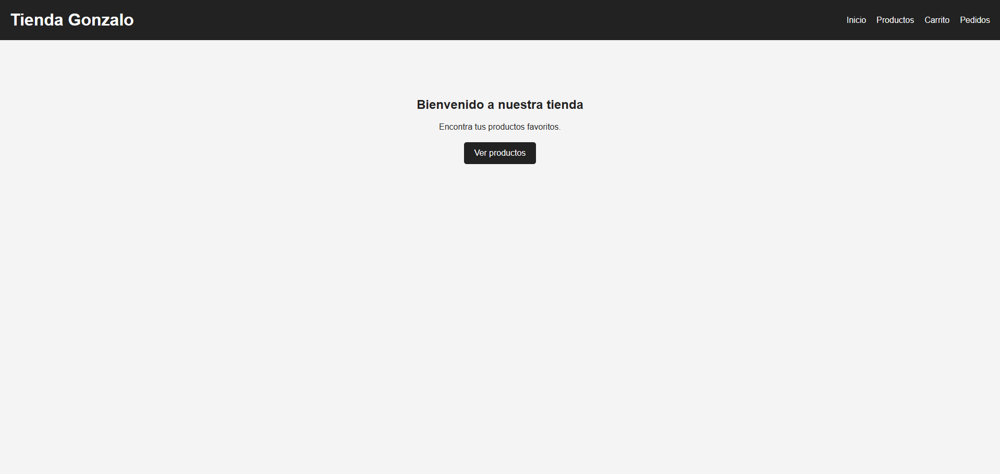
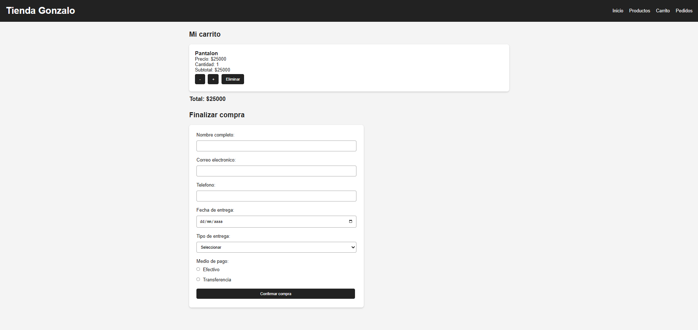
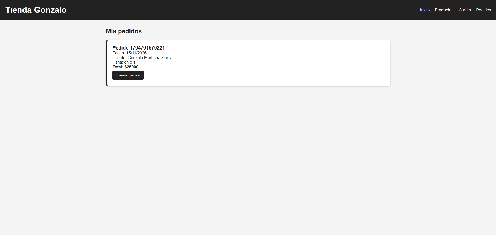
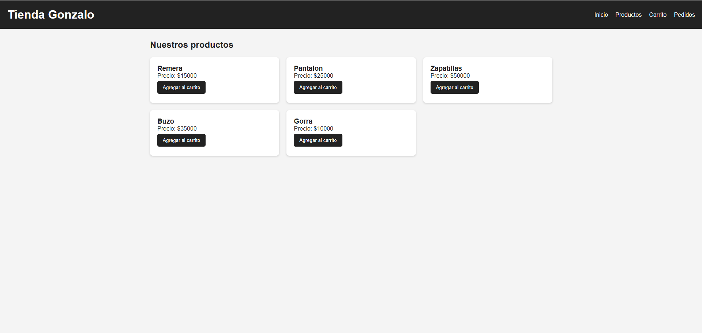

# Tienda Gonzalo - TP Programacion II

Pagina web de una tienda online hecha para un trabajo practico. La idea es poder ver los productos, armar un carrito de compras y guardar los pedidos en el navegador.

## Que use para hacerlo

* **HTML5:** Arme 4 paginas separadas para dividir cada seccion.
* **CSS3:** Use Flexbox y Grid para acomodar los elementos, media queries para que se vea bien en celular y tablet, y una animacion simple con `@keyframes`.
* **JavaScript:** Todo el manejo del DOM, la validacion del formulario y el guardado de datos con `localStorage`.

## Archivos del proyecto

* `index.html`: La pagina principal de bienvenida.
* `productos.html`: Donde se muestra el catalogo para agregar cosas al carrito.
* `carrito.html`: El resumen de lo que vas comprando, el total a pagar y el formulario para cerrar la compra.
* `pedidos.html`: El historial con los pedidos que ya confirmaste (y la opcion para borrarlos).
* `styles.css`: Todos los estilos de la pagina y las reglas para distintos tamaños de pantalla.
* `app.js`: El codigo que hace funcionar el carrito, los pedidos y las validaciones.

## Que se puede hacer en la pagina

* **Manejar el carrito:** Agregar productos, sumar o restar cantidades, borrar alguno y que se calcule el total solo.
* **Guardar los datos:** Como usa `localStorage`, si cerras o recargas la pagina no se pierde ni el carrito ni los pedidos.
* **Validar el formulario:** Chequea que completes bien los datos antes de confirmar la compra.
* **Verla en cualquier pantalla:** Se adapta si la abris desde la compu, una tablet o el celu.

## Como probarla

1. Descarga la carpeta del proyecto.
2. Hace doble clic en `index.html` para abrirla en Chrome o el navegador que uses. No hace falta instalar nada.

## Capturas

---
Hecho por Gonzalo Martinez Zinny